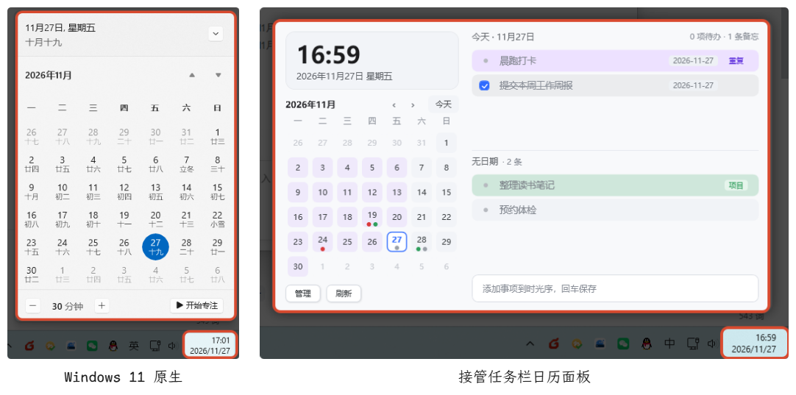

# 任务栏日历

点一下任务栏右下角的时钟，就在时钟上方弹出你当天的事项——不用切窗口，也不用手忙脚乱找 App。

事项数据来自时光序，面板里看到的就是时光序里的内容；在面板上勾掉的待办，也会同步回时光序。

## 功能

| 功能 | 说明 |
| --- | --- |
| 点击时钟弹出 | 点一下任务栏时钟，面板出现在时钟上方 |
| 今日事项 | 显示当天到期、逾期和已完成的事项 |
| 无日期清单 | 列出没有排期的待办与备忘 |
| 勾选完成 | 勾上即完成，点回来可撤销 |
| 快速新建 | 写一句话即可新建，自动归到「待办」 |
| 立即刷新 | 面板底部一键同步时光序 |
| 关于页 | 查看版本、数据目录与开机启动 |

日历里用颜色区分事项类型：

| 标记 | 含义 |
| --- | --- |
| 灰点 | 待办 / 备忘 |
| 绿点 | 项目 |
| 红点 | 重要 |
| 淡紫底色 | 这一天有重复事项 |

快速新建在面板底部的输入框里直接写，回车即创建：

| 识别 | 示例 |
| --- | --- |
| 日期 | `今天`、`明天`、`后天`、`大后天`、`3 天后`、`周五`、`下周一`、`11 月 30 日`、`30 号` |
| 时间 | `下午三点`、`15:30`、`9 点 20 分`、`七点半` |

识别到的日期与时间会用不同颜色标出，标题行也会预览这条会落在哪天。

## 使用

1. 下载 Release 里的 `TaskbarCalendar.exe`，放到任意文件夹后双击运行，程序会常驻并接管任务栏时钟点击。
2. 第一次运行会在 exe 同目录生成 `data` 文件夹，用于缓存事项。

## 数据与隐私

- 所有事项只缓存在本机 `data` 文件夹，不上传任何第三方服务器。
- 程序通过你已登录的时光序桌面端获取数据，不会保存你的账号密码。
- 如果提示「未找到时光序登录信息」，打开一次时光序桌面端并登录，再点面板上的「刷新」即可。

## 系统要求

- Windows 10 / 11（64 位）
- 已安装并登录时光序桌面端
- 无需另外安装 .NET 运行时
